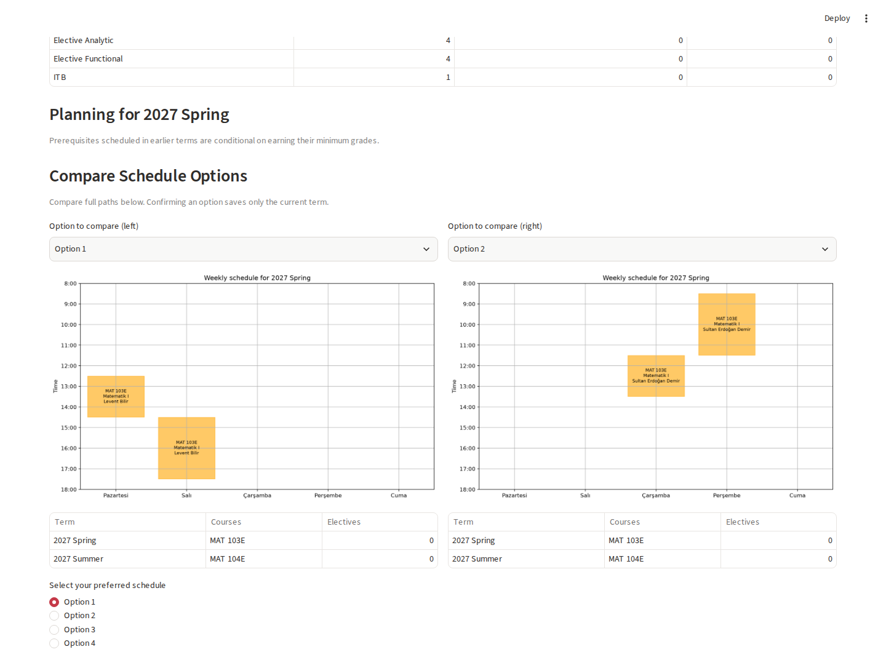

# Course Planner

Course Planner builds semester-by-semester schedules for an Industrial Engineering curriculum. It uses PySCIPOpt to enforce course requirements, prerequisite order and timetable conflicts, then lets you compare options and confirm a plan one term at a time.



## Run locally

Install [uv](https://docs.astral.sh/uv/getting-started/installation/) and run these commands from the repository root. The project targets Python 3.12.

```bash
uv sync --locked
uv run --locked streamlit run app.py
```

Run the same lint and test checks as CI.

```bash
uv run --locked ruff check .
uv run --locked pytest -q
```

## Try the example

1. Select **Load example plan** to use a simulated transcript with MAT 103E and MAT 104E left to schedule.
2. Compare two options and confirm the current term. The planner updates the graduation summary and calculates the next term.
3. Open **Export a confirmed timetable (.ics)**, choose the actual first and last teaching dates, and download the calendar. Events follow the weekly timetable in Istanbul time.

For your own plan, enter completed courses, any applicable grade overrides and a planning window. A maximum credit load is a hard constraint. A preferred free day ranks plans that are otherwise equivalent. You can also exclude summer terms.

## How planning works

- Each historical section is selected as a unit with all of its weekly meetings.
- The curriculum determines which courses are required. The bundled elective targets are four analytic, four functional and one ITB course. Completed courses and confirmed terms count toward those targets.
- Prerequisites support minimum grades and grouped alternatives. A course planned in an earlier term satisfies a prerequisite provisionally, subject to earning the required grade.
- The solver prefers fewer semesters and fewer courses, then applies any free-day preference. It can return feasible options found before the search limit. Missing sections and unreadable prerequisite rules are reported separately.

## Data and CSV uploads

The bundled [curriculum](data/course_plans.csv) and [lecture archive](data/all_lectures.csv) are historical snapshots. The archive contains 12,194 rows from 2017 Summer through 2022 Fall. Future timetables are projections from that archive. The repository history does not record the original extraction or redistribution terms for the CSVs. The [MIT license](LICENSE) applies to the application code. For official curriculum information, consult the [İTÜ Registrar's course-plan listing](https://obs.itu.edu.tr/public/DersPlan/DersPlanDetay/1427).

Choose **Use my CSV files** to replace either input in the current session. Use comma-separated UTF-8 files up to 5 MiB and 50,000 rows each. The bundled CSVs and [small test fixtures](tests/fixtures) show the formats.

| File | Required columns |
| --- | --- |
| Curriculum | `Semester`, `Course Code`, `Course Name`, `Credits`, `Prerequisites`, `Type` |
| Lecture history | `Kod`, `Ders`, `Eğitmen(ler)`, `Gün`, `Saat`, `Bina`, `Kayıtlı`, `Kontenjan`, `Bölüm sınırlaması`, `Term` |

Use terms such as `2025 - 2026 Güz Dönemi`. When several rows belong to the same section, include a shared `CRN` so the planner can group their meetings. You can set the department filter and elective targets for the selected data.

## Code layout

The Streamlit entry point is [app.py](app.py). The [planning package](src/course_planner) contains the CSV pipeline, curriculum rules, scheduling domain, solver, and calendar export. [Tests](tests) cover the planner and the application flow with bundled data.
